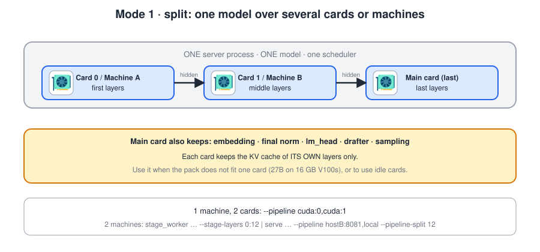
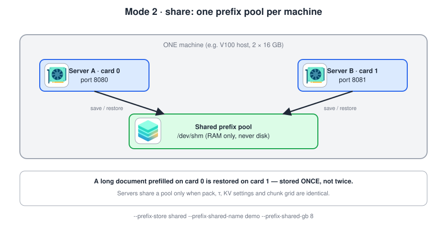
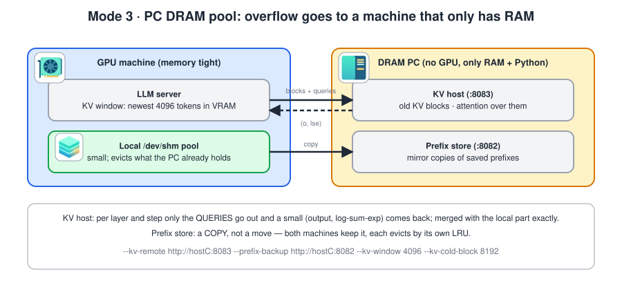
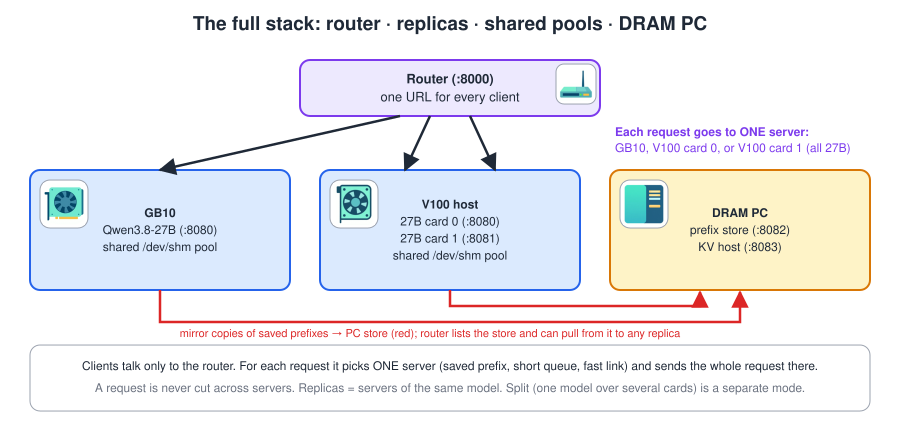
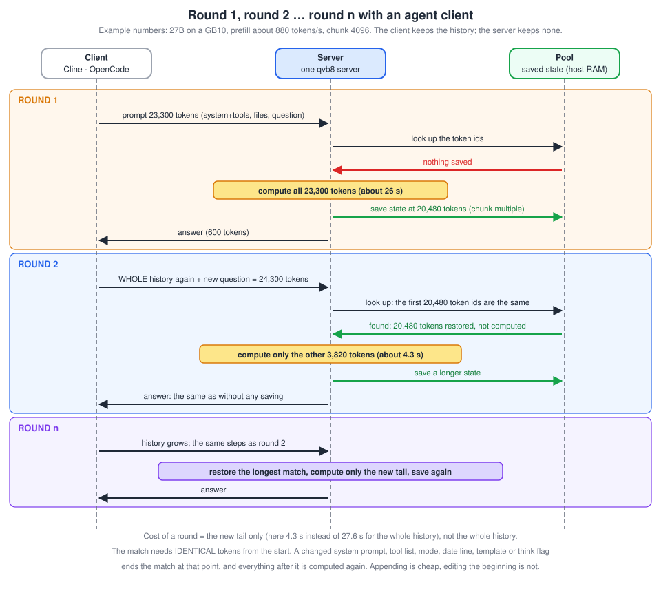
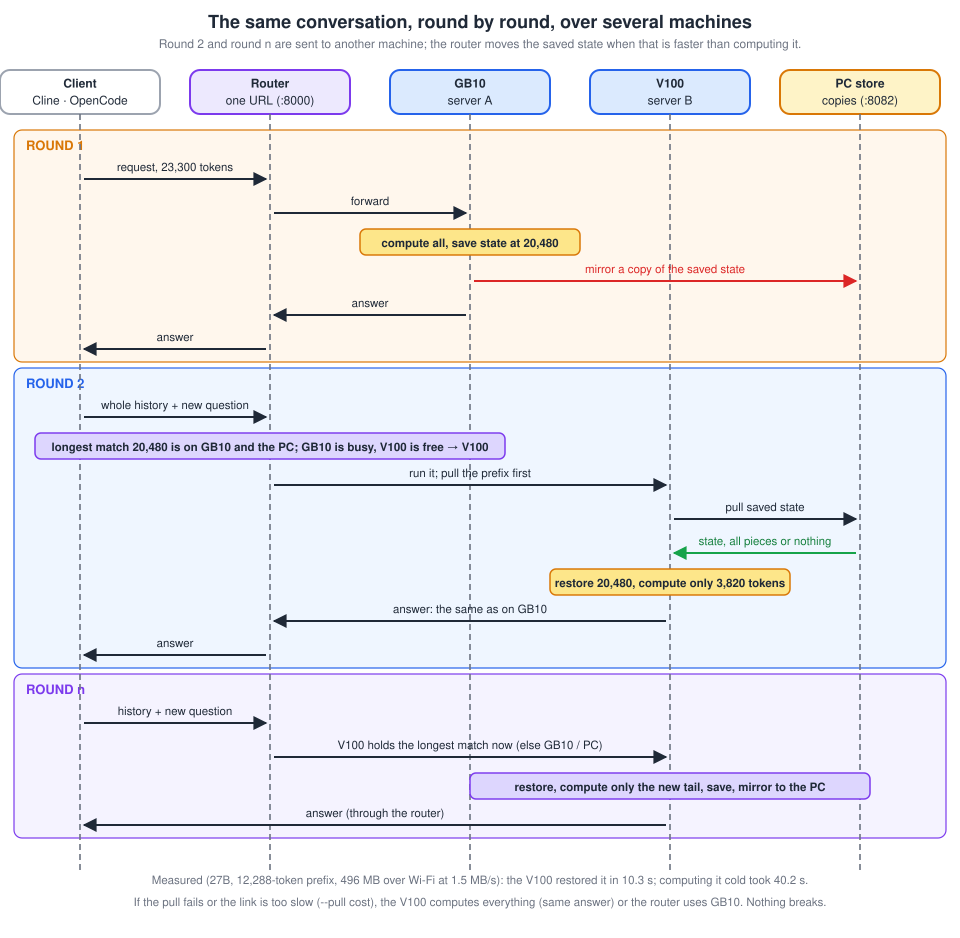
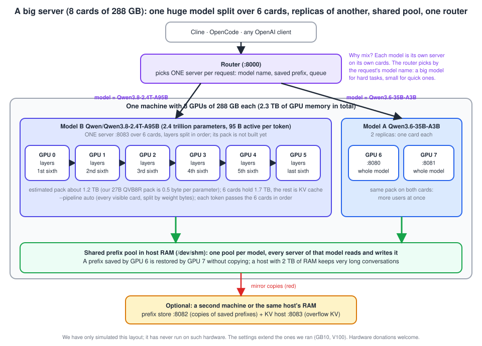
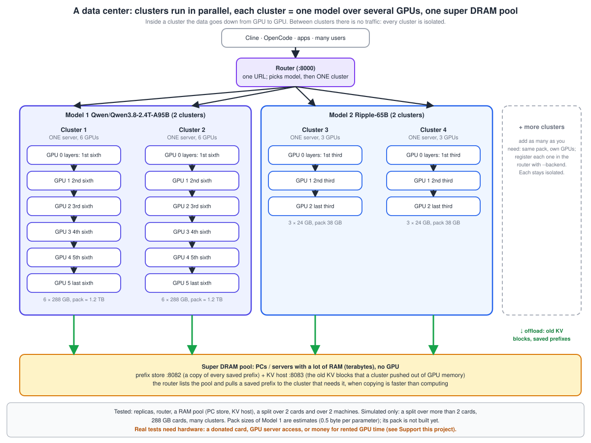
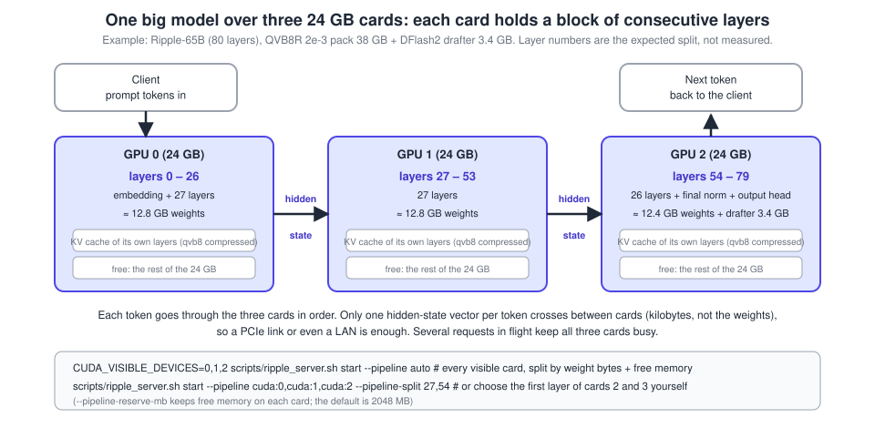
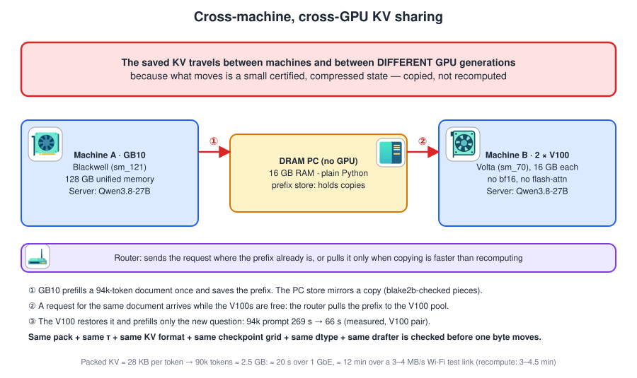

# Certified L∞ Bounded Compression for AI Models - QVB8 Inference Engine

QVB8 stores model weights in a compressed format where **the error of every restored weight is guaranteed to be less than the
error bound τ**. The engine runs the compressed weights directly on the GPU: custom CUDA kernels decode them inside
the matmuls, so large models run on small hardware. It provides an OpenAI-compatible HTTP server and a terminal chat
client, with DFlash2 speculative decoding.

> **New in v1.2.0 — certified KV cache that moves between machines.** The saved KV state is certified data (a proven error
> bound), defined by its numbers and not by a GPU. A prompt prefilled on a DGX Spark (Blackwell) is restored on a V100
> (Volta) instead of being computed again, with the same answer: [see how and what we measured](#kv-cache-shared-between-machines-and-between-different-gpus).
> **A 27B model on one 16 GB GPU:** Qwen3.8-27B (QVB8R 2e-3) with its QVB8R DFlash2 drafter runs on a single V100 16 GB
> (`./qvb8 get qwen-27b && ./qvb8 start qwen-27b`), or on two 16 GB cards with `--pipeline auto`. On one card the memory is
> tight: short prompts work; the limit for long prompts and the V100 speed are **TBA** (measurements in progress).
> New too: `./install.sh` and `./qvb8 start qwen-9b` for a three-step start, and `--pipeline auto` for several cards.

The engine is general CUDA code. **Version 1 provides a build for the NVIDIA DGX Spark (GB10, sm_121, aarch64).**

## Why certified L∞-bounded compression?

Most quantization is judged by an average: a perplexity or benchmark score. An average hides the worst case. A format can
look good on average and still leave a few weights with a large error, and a large error in the wrong weight can flip a
single token. The result is a sudden wrong word or a stray character from another language in the middle of a normal
answer, which an average score may not show. In our own tests with a 4-bit floating-point format we saw this in server logs.

L∞-bounded means the **largest** error is controlled, not the average. For a QVB8 pack:

- every restored weight differs from the original by less than **τ**, and no tensor is allowed to exceed it;
- the check is made after packing, tensor by tensor, and the largest error found is stored in `manifest.json` (`max_err`);
- τ is your choice: a smaller τ is a tighter bound, a larger file and a perplexity closer to the original; a larger τ is
  a smaller file and a higher perplexity. You choose the trade-off knowing the worst case.

What the bound does **not** do: it covers the stored weights only. It does not promise that the model's answers are
identical to the original's, or correct. See the disclaimer at the end of this file.

## What this version supports

- **Model type:** large language models (text in, text out; image input for the Qwen models), served through a chat API.
- **Model families** (each has an adapter in `src/qv_band/models/`; a pack directory is recognised by its own config):

| Family | Models | Launcher | Drafters | Status of this build |
|---|---|---|---|---|
| **Ripple** (dense) | Ripple-65B-Preview | `scripts/ripple_server.sh` | DFlash2 | tested on a DGX Spark |
| **Qwen** (dense, hybrid Gated-DeltaNet) | Qwen3.5-9B, Qwen3.8-27B | `scripts/qwen_server.sh` | DFlash, DFlash2, DSpine | tested on a DGX Spark |
| **Qwen** (mixture of experts) | Qwen3.6-35B-A3B | `scripts/qwen_server.sh` | DFlash2 | tested on a DGX Spark |
| **Nemotron-H** (Mamba-2 / attention / latent MoE) | Nemotron-3.5-Bolt-74B-A9B | `scripts/nemotron_server.sh` | LiLiCorr | code included, **not re-tested in this build** (no pack on the build machine) |

- **Weight formats:** QVB8 and QVB8R packs (QVB8R is the smaller, entropy-coded variant).
- **Interfaces:** an OpenAI-compatible HTTP server (streaming, tool calls, reasoning output) and a terminal chat client.
- **Hardware:** one GPU, or several in one machine (`--pipeline cuda:0,cuda:1`, one process, the layers split across
  the cards), or several machines (a remote stage worker runs a layer range on another box).
- **KV cache:** the certified compressed KV cache, with optional offload of the cold history to system RAM
  (`--kv-window` / `--kv-host`) for long contexts.
- **Saved prompt prefixes:** a repeated prompt or the next chat turn restores its saved state and prefills only what is
  new; with `--prefix-store shared` the servers of one machine share one pool in RAM.
- **Admission control:** limits on live requests, live tokens and the waiting queue (HTTP 429 / 503 with Retry-After).
- **Not in this version:** image, video and audio models, creating packs, int8 prefill, the MTP / DSpark drafters, a
  CPU path. Published packs so far are the Ripple packs below; the launchers take any local pack directory.

## Quick start (three steps, no setup knowledge needed)

Linux with an NVIDIA GPU and its driver. Nothing else to install by hand.

```bash
git clone https://github.com/addiesam/qvb8.git && cd qvb8
./install.sh                 # creates .venv, installs PyTorch + packages, checks the GPU (about 10 minutes)
./qvb8 get qwen-9b           # downloads the model (9 GB)
./qvb8 start qwen-9b         # starts the server in the background on port 8080 (first start: a few minutes)
./qvb8 chat                  # chat in the terminal   (or point any OpenAI client at http://localhost:8080/v1)
./qvb8 stop                  # when you are done
```

`./qvb8 list` shows the models you can run: `qwen-9b` and **`qwen-27b`, which fits one 16 GB card** (a V100: the 27B
QVB8R pack 2e-3 plus its QVB8R DFlash2 drafter run on 16 GB of GPU memory). Settings for a small card (smaller chunk,
KV window, one live request) are chosen automatically from its memory. Attention uses `sdpa`, which works on every card; on an
Ampere or newer card `ATTN=flash_attention_2 ./qvb8 start qwen-9b` is faster but needs flash-attn (see Install below).
Tested GPUs: DGX Spark (GB10) and V100. Several cards, several machines, Ripple and Nemotron: see the sections below.

## Requirements

- An NVIDIA GPU with about 62 GB of GPU memory for the qvb8 1e-3 pack (about 50 GB for the qvb8r 1e-3 pack).
- **Provided build:** NVIDIA DGX Spark (GB10, sm_121, aarch64), Ubuntu 24.04, driver 580, CUDA 13.0, Python 3.12, PyTorch 2.14.
  This is the build that has been tested. Its prebuilt CUDA kernels are bundled in the tree
  (`src/qv_band/.prebuilt/sm_121a/`), so a GB10 needs no CUDA toolkit: download, install the packages, run.
- **V100:** prebuilt kernels are bundled for it as well (`src/qv_band/.prebuilt/sm_70/`, built with PyTorch 2.14.1
  for CUDA 12.6): a V100 with that PyTorch also runs without a CUDA toolkit.
- **Other GPUs:** the source is not tied to one GPU. The kernels compile for your GPU on first use (for example sm_120 on an
  RTX PRO 6000; a few minutes, the CUDA toolkit with `nvcc` is required), but only the DGX Spark build is tested for Ripple.
- **Compute dtype, `--dtype bf16|fp16`:** the server launcher passes `--dtype fp16`; add `--dtype bf16` after it to
  run in bf16, for example `scripts/ripple_server.sh start --dtype bf16`. Nothing
  is chosen automatically. A GPU without bf16 support (for example the V100, sm_70) emulates bf16 and is slow, so run it
  in fp16. On a GPU with bf16 (A100, H100, RTX 30/40/50, DGX Spark) both work: test which is faster on your card. The
  packs below are certified for both fp16 and bf16, so the error of every restored weight is less than tau in either
  dtype. fp16 tops out at 65504, so an activation can overflow in fp16 where bf16 would not; compare a few answers
  against bf16 if you can.
- **`escape_tables.json` (needed for fp16):** each pack folder on Hugging Face carries this small file next to
  `manifest.json`. It holds the fp16 escape table: the few weights an fp16 decode must take from the stored originals.
  An fp16 run without it stops at start-up and tells you to download it; a bf16 run does not need it.
  For the V100 the code has its own kernel paths (register-blocked GEMV, WMMA attention) and needs CUDA 12.x, because
  CUDA 13 dropped sm_70. The V100 path is not yet verified on Ripple.
- Python 3.10+ (tested 3.12) and the packages in `requirements.txt` (tested versions pinned).
- A Ripple target pack and a DFlash2 drafter pack (each pack dir carries its own config, modeling code and tokenizer).

## Weight packs (Hugging Face)

The packs are published separately on Hugging Face, from [huggingface.co/addiesam](https://huggingface.co/addiesam).
Download one target pack and one matching draft pack:

| Model | Original (bf16, about) | Compressed with QVB8 / QVB8R | Small draft pack | All packs |
|---|---|---|---|---|
| Qwen3.5-9B | 18 GB | **7.6 GB** | 1.4 GB | [collection](https://huggingface.co/collections/addiesam/qwen35-9b) |
| Qwen3.8-27B | 54 GB | **13.6 – 21.6 GB** | 1.5 GB | [collection](https://huggingface.co/collections/addiesam/qwem38-27b) |
| Qwen3.6-35B-A3B | 70 GB | **about 30 GB** | 0.6 GB | [collection](https://huggingface.co/collections/addiesam/qwen36-35b-a3b) |
| Ripple-65B-Preview | 130 GB | **35.5 – 57 GB** | 3.4 – 4.1 GB | [collection](https://huggingface.co/collections/addiesam/ripple-65b-preview-qvb8) |

The compressed size depends on the format and the error bound tau: `qvb8` is faster, `qvb8r` is smaller, a larger tau is
smaller still. Each pack's size, format and tau are on its Hugging Face page. Rule of thumb: the pack must fit in GPU
memory with some room for the KV cache; **a 16 GB card runs the 27B** (QVB8R 2e-3, 13.6 GB; long prompts on one card: TBA).

Every pack: [huggingface.co/addiesam](https://huggingface.co/addiesam).

Each target pack is used together with a drafter pack (`./qvb8 get/start` downloads and starts the pair for you): `qwen-27b`
= Qwen3.8-27B qvb8r 2e-3 + its DFlash2 qvb8r 5e-3 drafter, `qwen-9b` = Qwen3.5-9B qvb8 1e-3 + its DFlash qvb8 1e-3 drafter.

```bash
pip install -U huggingface_hub
hf download addiesam/Ripple-65B-Preview-QVB8-1e-3 --local-dir ./models/Ripple-65B-Preview-QVB8-1e-3
hf download addiesam/Ripple-65B-Preview-DFlash2-QVB8-5e-3 --local-dir ./models/Ripple-65B-Preview-DFlash2-QVB8-5e-3
```

## Install

```bash
git clone https://github.com/addiesam/qvb8.git && cd qvb8
python -m venv .venv && . .venv/bin/activate
# 1. PyTorch with CUDA support for your platform (see pytorch.org). Tested: 2.14.0 built for CUDA 13.0.
# 2. The other packages:
pip install -r requirements.txt
# 3. flash-attn: REQUIRED for Ripple (its sliding-window attention layers use it; the server stops at load without it).
#    It must be built against your PyTorch:  pip install flash-attn==2.8.3.post1 --no-build-isolation
#    With PyTorch 2.14 the 2.8.3.post1 source needs one change before it compiles: its setup.py passes -std=c++17 and
#    PyTorch 2.14's headers need C++20. Unpack the sdist, replace every -std=c++17 in setup.py with -std=c++20, then
#    pip install . --no-build-isolation. To build for one GPU generation only, set FLASH_ATTN_CUDA_ARCHS (for example
#    FLASH_ATTN_CUDA_ARCHS=80 for RTX 30/40 cards, 120 for a DGX Spark); TORCH_CUDA_ARCH_LIST is not read by that setup.py.
```

On a GB10 (or a V100 with the matching PyTorch) the bundled prebuilt kernels are used as-is: no compile, no CUDA
toolkit. On any other GPU the CUDA kernels compile automatically on first use (a few minutes, `nvcc` required) into
`.ext_cache/` and are reused after that.

<div align="center">

# ❤️ SUPPORT THIS WORK ❤️

## I am an independent researcher and I need machines to test on.
## Every sponsor helps me publish more models, for free.

# 👉 [**SPONSOR DR. ADDIE SAM ON GITHUB**](https://github.com/sponsors/addiesam) 👈

[](https://github.com/sponsors/addiesam)

</div>

## Run the server

```bash
export MODEL=./models/Ripple-65B-Preview-QVB8-1e-3
export DRAFT=./models/Ripple-65B-Preview-DFlash2-QVB8-5e-3
scripts/ripple_server.sh            # start in the background, wait until ready
scripts/ripple_server.sh status
scripts/ripple_server.sh log        # follow scripts/logs/Ripple-65B.log
scripts/ripple_server.sh startup    # the load / placement / kernel / memory lines from this start
scripts/ripple_server.sh stop
scripts/ripple_server.sh restart --no-think    # extra flags go to the server and win
```

A Qwen model (dense or mixture of experts) and a Nemotron-H model start the same way with their own launcher; each
launcher's header lists its settings:

```bash
MODEL=./models/Qwen3.8-27B_qvb8r_2e-3_fp16 DRAFT=./models/Qwen3.8-27B-DFlash2_qvb8r_5e-3_fp16 DRAFT_K=7 \
  scripts/qwen_server.sh
MODEL=./models/Qwen3.6-35B-A3B_qvb8_5e-4_fp16 DRAFT=./models/Qwen3.6-35B-A3B-DFlash2_qvb8_1e-3 DRAFT_K=7 \
  scripts/qwen_server.sh
MODEL=./models/NVIDIA-Nemotron-3.5-Bolt-74B-A9B_qvb8_1e-3_fp16 DRAFT=./models/NVIDIA-Nemotron-3.5-Bolt-74B-A9B-24GB-LiLiCorr \
  scripts/nemotron_server.sh
```

More than one card in one machine: add `--pipeline auto` (every visible card) or `--pipeline cuda:0,cuda:1` (the
cards you choose, in layer order; the last is the main card). **The layers are placed automatically** from each layer's
weight size and each card's free memory (cards of different sizes work; the split is printed at load); `--pipeline-split`
sets it by hand. One process; each card holds a contiguous range of layers, so a pack larger than one card's memory loads.
Several machines: run `python -m ai_engine.cli.stage_worker $MODEL --stage-port 8081 --stage-layers 0:12` on the
other box and add `--pipeline host:8081,local --pipeline-split 12` here. Set the same `QV_POOL_TOKEN` in the
environment of both processes: the stage worker then accepts only a main server that presents it (without a token the
port is open to the network it listens on). A neighbour that loses power or its link is detected within about a minute.

Default port is 8080 (override with `PORT=...`). The server speaks the OpenAI chat API:

```bash
curl http://127.0.0.1:8080/v1/chat/completions -H 'Content-Type: application/json' \
  -d '{"messages":[{"role":"user","content":"Write a haiku about rivers"}],"max_tokens":200,"stream":false}'
```

It supports streaming, tool calls (JSON) and the reasoning (`<think>`) channel. It also accepts content-part lists,
as sent by Cline and similar clients.

## Chat in the terminal

The chat is a client for a running server (it loads no model; standard library only):

```bash
scripts/chat.sh                                 # interactive, server on port 8080
scripts/chat.sh "Explain entropy" --no-interactive
PORT=9090 scripts/chat.sh                       # a server on another port
URL=http://host:8080 scripts/chat.sh --no-think  # a server on another machine
```

In the chat: `/reset` starts a new conversation, `/exit` (or Ctrl-D) leaves, Ctrl-C stops the current answer.

## Use it from VS Code (Cline) and other clients

The server speaks the OpenAI chat API, so any client that lets you set a base URL works. For **Cline** in VS Code:
Settings → API Provider **OpenAI Compatible**, then

| Cline field | Value |
|---|---|
| Base URL | `http://HOST:8080/v1` (a single server) or `http://HOST:8000/v1` (the router) |
| API Key | any text (the server does not check it) |
| Model ID | any text with one model up; with a router and several models, a name from `GET /v1/models` |
| Context window | what you want to use, up to the server's limit (a 16 GB V100: 32768 is a good start) |

We have tested the request format Cline sends (content-part lists, streaming, tool calls); we have not run a long Cline
session ourselves. The same settings work for Continue, Open WebUI, `curl` and the OpenAI Python client.

### Keep the conversation going, also on another machine

The server keeps no conversation. The client (Cline, your script) sends the **whole history** with every message. What
the server saves is the *computed state of the beginning of that history* (the prefix), so the next message does not
compute it again. Therefore you can point the client at another server at any moment and the conversation continues
with the same answers; only the **speed** depends on whether the new server has the prefix:

| Where the next message goes | What happens |
|---|---|
| Same server | the saved prefix is restored: only the new part is computed |
| Another server on the same machine (another card) | restored from the shared pool (`--prefix-store shared`), instantly |
| Another machine, through the **router** with a PC store | the router pulls the prefix there when that is faster than computing it (also from a GB10 to a V100) |
| Another machine, no router / no store | the whole history is computed again: same answer, slower |
| A server with another pack, τ or KV setting | the prefix is refused (different signature) and computed again |

A prefix matches only if the beginning is **identical**: same system prompt, same chat template, same `think` setting.
The terminal chat (`scripts/chat.sh`) keeps its history only in that window; to continue elsewhere use a client that
stores the conversation, such as Cline. Details and commands: [docs/manual.md](docs/manual.md), section 9.

## Use cases: one card, many cards, many machines

Three independent switches decide where the bytes live. Full manual with every command: [docs/manual.md](docs/manual.md).

| Switch | Question | Example |
|---|---|---|
| **split** | Where do the weights live? | 27B on two 16 GB V100s: `--pipeline cuda:0,cuda:1` |
| **share** | Where do saved prompt prefixes live? | two servers on one box, one RAM pool: `--prefix-store shared` |
| **PC pool** | Where does the overflow live? | a GPU-less PC holds old KV and copies of prefixes: `--kv-remote`, `--prefix-backup` |

**Why saved prefixes matter.** Prefilling a long prompt takes minutes. The engine saves the state; the next request with
the same beginning (the same document, the next turn of a chat) restores it and prefills only what is new. A 94k-token
prompt: **269 s → 66 s** (V100 pair).

### Split: one model over several cards or machines



```bash
MODEL=./models/Qwen3.8-27B_qvb8r_2e-3_fp16 DRAFT=./models/Qwen3.8-27B-DFlash2_qvb8r_5e-3_fp16 DRAFT_K=7 \
ATTN=sdpa MAX_LIVE=1 scripts/qwen_server.sh start --pipeline cuda:0,cuda:1
```

### Share: one prefix pool per machine



```bash
CUDA_VISIBLE_DEVICES=0 INSTANCE=c0 PORT=8080 scripts/qwen_server.sh start --prefix-store shared --prefix-shared-name demo
CUDA_VISIBLE_DEVICES=1 INSTANCE=c1 PORT=8081 scripts/qwen_server.sh start --prefix-store shared --prefix-shared-name demo
```

A document prefilled on card 0 is restored on card 1: stored once, not twice.

### PC DRAM pool: overflow to a machine that only has RAM



```bash
python -m ai_engine.servers.prefix_store --mirror http://hostA:8080 --port 8082     # on the PC, standard library only
python -m ai_engine.servers.kv_host --port 8083 --budget-gb 8                      # on the PC
scripts/qwen_server.sh start --prefix-backup http://pc:8082 --kv-remote http://pc:8083 --kv-window 4096
```

### Everything together: router, replicas, pools, PC



One router URL for all clients; the router chooses the replica by queue, prefix hit and link speed.
Step-by-step start-up of the whole stack: [docs/manual.md](docs/manual.md#6-the-full-stack-step-by-step).

### Several rounds with an agent (Cline, OpenCode): what is computed, what is saved

An agent sends the **whole history again in every round**. The server keeps no conversation; it keeps the computed state
of the beginning of the history. Round 1 computes everything and saves that state; round 2 finds the same beginning,
restores it and computes **only the difference**:



If round 2 reaches another machine or card, the router moves the saved state there (when that is faster than computing):



Step by step, with all cases: [docs/manual.md](docs/manual.md), section 10.

### It is a toy on a desk, and it scales to a real server

A replica, a split, a pool and a router are the same four parts on a 16 GB card and on a rack machine; a big server just
has more of each. Below: a deployment for an 8-GPU machine with 288 GB per card. One huge model, `Qwen/Qwen3.8-2.4T-A95B`
(2.4 trillion parameters, estimated pack about 1.2 TB), is split over 6 cards; another model runs as two replicas on the
other 2 cards; a shared pool and one router sit in front. **We have only simulated this layout; we have never run it on H100 /
H200 / H300 cards.** The settings extend the ones we did run (GB10, V100, a PC store).
**To test it for real I need the hardware: GPU time, a card, or money to rent one. If you can donate any of these, please
see [Support this project](#support-this-project).** Commands in [docs/manual.md](docs/manual.md), section 11.



A data center: many isolated clusters run in parallel (each cluster = one model over several GPUs, layers in order), and every cluster offloads to a super DRAM pool. Again simulated only:



One model too big for one card, over three 24 GB cards (each card holds a block of consecutive layers; `--pipeline auto`):
(We ran the split over two cards only; three or more cards have been simulated, not run on real cards.)



## KV cache shared between machines and between different GPUs



**A prompt prefilled on one machine is restored on another machine with a different GPU, instead of being computed
again.** The approach is deliberately simple:

> The saved KV is *certified* data: integer ids plus a per-channel (min, step), value = min + id × step, with a proven
> error bound τ. It is defined by the numbers, not by a GPU or a kernel, so any machine can restore it. Moving it is a
> plain file copy with a hash check.

In our set-up a DGX Spark (Blackwell, sm_121) and V100 cards (Volta, sm_70, no bf16, no flash-attn) exchange saved
prefixes of the same model, through a GPU-less PC that only runs plain Python. This is a different design from the
big serving engines, not a claim of being better at everything; it is simple, and it works on the machines we have.
**We have tested it on these two GPU types only. If you try it on yours, please tell us how it went (GitHub issues).**

What makes this possible:

- **What moves is small and exact.** The saved state is the certified, compressed KV (L∞-bounded, about 28 KB per token
  for the Qwen3.8-27B), not raw 16-bit KV. Its error bound holds on whatever hardware restores it.
- **It is copied, not recomputed.** The receiver publishes a prefix only after every piece arrived and its blake2b hash
  matched. A failed pull costs nothing but the prefill it would have saved.
- **Safe by signature.** Both sides must report the same transfer signature (pack and τ, KV τ, KV residual, checkpoint
  grid, dtype, drafter) before one byte moves.
- **Cost-aware router.** A prefix is pulled only when copying is faster than recomputing, using the link speed it has
  measured.
- **The store needs no GPU and no extra service.** A 16 GB PC with Python holds the copies.

### What we measured (release v1.2.0, 2026-11-15)

Qwen3.8-27B (qvb8r, τ 2e-3, fp16), one prompt of 15,316 tokens, greedy, one run each. A GB10 and one V100, a PC store, and
the router. This is a functional check, not a benchmark; the network is a Wi-Fi test link.

| Step | Result |
|---|---|
| GB10 prefills the prompt (cold) | 19.8 s; the same prompt again, restored from its own pool: 4.9 s |
| V100, a different prompt of the same length (cold) | 40.2 s |
| V100 pulls the saved prefix (12,288 tokens, 496 MB) from the GB10 | 335 s at 1.5 MB/s on Wi-Fi (about 5 s at 1 Gb/s, calculated) |
| V100 answers the same prompt after the pull | **restored 12,288 of 15,316 tokens, prefilled 3,028: 10.3 s**, answer identical to the GB10's |
| Router, same prompt | sent to the V100 that holds the prefix (14,336 tokens cached): 4.3 s |

Both servers printed the same transfer signature before anything moved. The two GPUs are different generations
(Blackwell sm_121a, Volta sm_70).

## Compared with SGLang

SGLang is a fast, mature serving engine. We compare design ideas, not speed. This comparison is from its public
documentation ([HiCache design](https://docs.sglang.io/advanced_features/hicache_design.html),
[PD disaggregation](https://docs.sglang.io/advanced_features/pd_disaggregation.html), read 2026-11-15); **we did not
benchmark SGLang**, so there are no speed claims here.

**SGLang can also share KV between instances and machines**: its HiCache has a third tier (L3, a distributed store such
as Mooncake, 3FS or NIXL) shared by all instances, and its prefill/decode disaggregation moves KV between machines. The
difference is *what* is shared and *what it takes*:

| | SGLang (public docs) | QVB8 |
|---|---|---|
| KV shared between machines | yes: HiCache L3, PD disaggregation | **yes: built in** (pool, transfer, store, router) |
| Host-RAM tier shared by the servers of one machine | no: L2 is private to one instance | **yes: one `/dev/shm` pool for all servers** |
| What is stored and moved | the KV in the model's KV dtype (16-bit; FP8 optional) | **certified L∞-bounded compressed KV**, about 28 KB/token (27B) |
| What the shared store needs | a deployed storage service (Mooncake, 3FS, NIXL, AIBrix) | **a PC with plain Python, no GPU** (`prefix_store.py`, standard library) |
| Mixed GPU generations in one deployment | transfer engines are device-agnostic; the docs give no compatibility matrix for mixed generations | **run and measured: GB10 (sm_121) + V100 (sm_70)** |
| Copy or recompute | per-backend policy | **router prices the copy against the prefill from the measured link speed** |
| Integrity | per backend | **blake2b per piece, all-or-nothing publish, signature checked first** |
| Weights compressed with a per-weight error bound | no | **yes: every restored weight is within τ** |

### The KV state itself: compressed and certified

This is where the designs differ most. Both systems can move a saved KV; what is *inside* the saved state is different.

| | SGLang (public docs) | QVB8 |
|---|---|---|
| Format of the saved KV | the model's KV dtype (bf16 / fp16), or FP8 (E4M3 / E5M2) | per-channel `(min, step)` plus integer ids: value = min + id × step |
| Scale | FP8: **one scalar per tensor**; if no scale is supplied it defaults to 1.0, which the docs warn "may cause accuracy issues" | **one `(min, step)` per channel**, stored inside the state |
| Error guarantee | none stated: "typically minimal degradation", larger drops on smaller models and harder reasoning | **certified**: every restored value is within the bound, by construction of the codec |
| Size, Qwen3.8-27B (16 full-attention layers × 4 KV heads × 256) | 64 KB/token in 16-bit, 32 KB/token in FP8 | **about 28 KB/token** (measured) |
| Restoring on another machine | HiCache storage layout depends on TP and layout settings; sharing between different TP sizes uses a documented extra setting (`tp_lcm_size`) | **nothing depends on the machine**: the state is just numbers; only the transfer signature has to match |
| Whether a restored KV is the same as the saved one | a copy of the stored tensors | a copy of the stored integers, hash-checked per piece |

Honest reading of the size row: FP8 is already about the size of our state (32 vs 28 KB/token, about 12 % apart). What
QVB8 adds is not a smaller number but a **guarantee** (a per-value bound that does not depend on a calibration scale)
and a state that is **independent of the machine that restores it**, so the same saved prefix can be restored on a GB10, a
V100 or any machine that reads the format.

Sources: [SGLang quantized KV cache](https://docs.sglang.io/advanced_features/quantized_kv_cache.html),
[SGLang HiCache best practices](https://docs.sglang.io/advanced_features/hicache_best_practices.html).

Where SGLang is ahead, and we do not claim otherwise: throughput at scale, tensor / expert / data parallelism, RDMA
transports, the number of supported model architectures, production maturity and community. QVB8 is a research engine
that runs a few model families (Ripple, Qwen, Nemotron-H) on a few machines.

## Supported options

The release supports GPU only. These are the supported settings (the defaults are in the launcher):

- `--kv-cache qvb8` (certified compressed KV) or `bf16`
- `--prefill-linear qvb8`
- `--drafter dflash` (DFlash, DFlash2, DSpine and LiLiCorr checkpoints or packs; the kind is read from the drafter's own
  config), `n-gram`, `n-gram_with_dflash`, or `--draft 0` for none
- `--pipeline cuda:0,cuda:1,...` (several cards in one machine; the last card is the main card). The layers are split
  by weight bytes and each card's free memory, keeping `--pipeline-reserve-mb` (default 2048) free on every card for
  activations and the KV cache, so cards of different sizes work; `--pipeline-split s1,...` sets the split by hand
- `--kv-window N|auto`, `--kv-host`, `--kv-cold-block T`, `--kv-gpu-reserve-mb M` (KV cache offload to system RAM)

- `--prefill-chunk N`: tokens per prefill pass. The saved state at a prompt's end sits on a chunk boundary, so a
  smaller chunk makes a repeated prompt or the next chat turn cheaper and a new long document a little slower
- `--prefix-store gpu|host|shared`, `--prefix-shared-name NAME`, `--prefix-shared-gb N`: where saved prompt prefixes
  live; `shared` is one pool in `/dev/shm` for every server of the machine
- `--max-live N`, `--max-live-tokens T`, `--max-queue N`, `--queue-wait S`: admission control (0 = no limit). A request
  enters the live batch only when it fits; the waiting queue is first in, first out; a full queue answers 429 and a
  wait past the limit 503, both with `Retry-After`

`--device cpu` is listed by the CLI help but is not part of this release.

## Speed (measured 2026-11-16, DGX Spark GB10)

Release code and launcher as shipped (`./qvb8 start`-style settings, `ATTN=sdpa`, KV cache qvb8, speculative decoding),
greedy (temperature 0), thinking off, 400 generated tokens, streaming; the second of two runs of each prompt. One
measurement per row on an otherwise idle machine, so read the numbers as a reference, not a promise.

| Pair (target + drafter) | Decode, code | Decode, prose | Two requests at once (total) | **Prefill** (57k-token prompt) |
|---|---|---|---|---|
| Qwen3.8-27B **qvb8 1e-3** + DFlash2 qvb8r 5e-3 (K=7), `--prefill-chunk 12288` | **18.7 tok/s** | **14.4 tok/s** | **23.9 tok/s** | **about 980 tok/s** (58 s) |
| Qwen3.6-35B-A3B qvb8 5e-4 + DFlash2 qvb8 1e-3 (K=7) | **53.6 tok/s** | **37.2 tok/s** | **50.2 tok/s** | **about 1,920 tok/s** (30 s) |
| Qwen3.8-27B qvb8r 2e-3 + DFlash2 qvb8r 5e-3 (K=7), the 16 GB-card pack | 15.5 tok/s | 12.0 tok/s | 18.9 tok/s | about 760 tok/s (75 s) |
| Qwen3.5-9B qvb8 1e-3 + DFlash qvb8 1e-3 (K=15) | 62.7 tok/s | 45.1 tok/s | 68.8 tok/s | about 2,700 tok/s (21 s) |

The 27B qvb8 row was also measured with chunk 4096 (about 880 tok/s) and 24576 (about 855 tok/s): 12288 is the fastest on the GB10.
The qvb8 pack is faster than the qvb8r pack (qvb8r is smaller: 13.6 GB instead of 21.6 GB, which is what lets the 27B fit
one 16 GB card). Prefill uses the int8 path (`--prefill-linear qvb8`) on a qvb8 pack.

Code is faster than prose because the drafter guesses code better (more drafted tokens are accepted per step).
Speculative decoding is verified by the full model; in our tests greedy output matched plain decoding, and where two
tokens are an exact near-tie the choice can differ.

**V100 (16 GB) speed: TBA.** The V100 decode and prefill numbers for this release are being measured and will be added here.

## Update history

**v1.2.0**
- All LLM families of the engine: Qwen (dense and mixture of experts) and Nemotron-H join Ripple, each with its own
  launcher; `scripts/ripple_chat.sh` is now `scripts/chat.sh` (it talks to any server).
- New drafter kind: DSpine (`tencent/Qwen3.8-27B-DSpine-b16`), from the checkpoint or a qvb8 / qvb8r pack of it.
- `--pipeline auto` uses every visible card; the layers are placed automatically from the weight size of each layer and
  each card's free memory (`--pipeline-split` still sets it by hand).
- Several cards with a main card other than `cuda:0` (GitHub issue #1): the main card is one indexed device for the
  whole process; the automatic split follows each card's free memory and checks the main card too.
- Admission control in the server; a scheduler that stops reports it (waiting requests fail, the server reports itself
  unusable) where clients used to wait for ever; the output budget is limited to the context left after the prompt; a
  non-streaming client that disconnects frees its slot; malformed request fields answer 400.
- Saved prefixes in a pool shared by the servers of a machine (`--prefix-store shared`); processes are identified by pid
  and start time, a failed save gives its room back, and a request that cannot fit no longer empties the pool.
- Saved prefixes move between machines (`/v1/pool/export`, `/v1/pool/pull`, hash-checked pieces, same transfer signature
  on both sides; `QV_POOL_TOKEN` protects these endpoints). Old KV can live on another machine, which computes the
  attention over it (`remote_cold` client).
- The release now includes the router (`ai_engine.servers.router`), the prefix store (`ai_engine.servers.prefix_store`)
  and the KV host (`ai_engine.servers.kv_host`), a deployment manual with diagrams (`docs/manual.md`), and `INSTANCE=`
  in the launchers (several servers of one launcher on one machine, each with its own log and pid file).
- Stage link between machines: token check, dead-peer detection, bounded message sizes.
- flash-attn is required for Ripple; the build note for flash-attn 2.8.3.post1 with PyTorch 2.14 is in the setup section.

**v1.1.0**
- The engine is updated to the current development code: the model runs through the engine adapter (the Ripple
  adapter is registered by name), the continuous-batching scheduler is the current one, and the KV cache gains the
  sliding-window layers and the certified per-channel codec of the current engine.
- Several GPUs in one machine: `--pipeline cuda:0,cuda:1` splits the layers across the cards in one process
  (placement by layer range; the last card is the main card). This replaces tensor parallelism, which is no longer
  in the engine.
- Several machines: a remote stage worker (`python -m ai_engine.cli.stage_worker`) runs a layer range on another
  box; the server reaches it with `--pipeline host:port,local --pipeline-split N`.
- KV cache offload to system RAM for long contexts: `--kv-window N|auto` keeps the last N tokens (or an automatic
  window) in VRAM and the cold history in pinned host RAM; `--kv-host` moves the whole cache to host RAM.
- The terminal chat is now a client for a running server (`scripts/chat.sh`, standard library only): it sends
  OpenAI-style requests and prints the answer; it loads no model and works from any machine that can reach the
  server.
- The server launcher passes `--dtype fp16` (measured faster on the DGX Spark) and `--kv-tau-threshold 0.2`; add
  `--dtype bf16` to run in bf16.
- The launcher keeps a startup log (`scripts/logs/Ripple-65B.startup.log`, action `startup`): the command line and
  everything the server printed until it answered the health check -- the load, placement, kernel and memory lines,
  apart from the request log.
- Prebuilt CUDA kernels are bundled in the tree (`src/qv_band/.prebuilt/`): sm_121a for the DGX Spark (PyTorch
  2.14.0 for CUDA 13.0) and sm_70 for the V100 (PyTorch 2.14.1 for CUDA 12.6). A machine with the matching PyTorch
  runs without a CUDA toolkit; the sidecar next to each kernel records the sources, torch and platform it was built
  for, and anything else compiles on first use as before. The sidecar match no longer binds to the torch install
  path.

**v1.0.1**
- One switch for the compute dtype: `--dtype bf16|fp16` (replaces the `QV_MODEL_DTYPE` variable). The launchers set
  the default; nothing is chosen automatically.
- Two escape tables: an fp16 run reads only the fp16 table from `escape_tables.json`; a bf16 run reads the pack's full
  list. The pack files are unchanged. In our test (QVB8-1e-3, fp16, DGX Spark, one prompt, greedy) decoding went from
  about 1.8 to about 5.7 tokens per second; bf16 is unchanged.
- An fp16 run needs `escape_tables.json` in the pack folder; without it, the engine stops with an error at start-up.
- The server log: a client that hangs up before the reply (for example a start-up health check) is one `[http] ...` line, not a traceback; an fp16 run no longer prints the bf16 GEMM count as if it were in use.

**v1.0.0: First release**
- QVB8 Inference Engine for Ripple-65B-Preview, with the QVB8 and QVB8R weight packs.

## Papers

The certified compression method (every restored weight within error bound τ of the original) and its use on language models
are described in:

> Sam, Chi Ngai. *Certified L∞-Bounded Compression for AI Models, I: The Contract and the Virtual-Band Index.*
> Zenodo, 2026. [doi:10.5281/zenodo.23815007](https://doi.org/10.5281/zenodo.23815007)

> Sam, Chi Ngai. *Certified L∞-Bounded Compression for AI Models, II: Compressing a Language Model's Weights, Key–Value Cache and Activations.*
> Zenodo, 2026. [doi:10.5281/zenodo.23816044](https://doi.org/10.5281/zenodo.23816044)

## License

The code is © 2026 Sam, Chi Ngai, licensed under [Apache-2.0](LICENSE) (see [NOTICE](NOTICE)).
Questions and bug reports: please open a [GitHub issue](https://github.com/addiesam/qvb8/issues).

The paper is licensed under CC BY-NC-ND 4.0.
The model weights are not part of this repository and keep their own license.

## Support this project

- **Individuals:** if this project is useful to you, please consider
  [sponsoring Dr. Addie Sam on GitHub](https://github.com/sponsors/addiesam).
- **Hardware or GPU time:** I have not been able to test on H100 / H200 / H300 servers or on three or more cards. A donated card,
  access to a GPU server, or money for rented GPU hours directly decides what gets tested next. Open an issue or contact
  the author through [github.com/addiesam](https://github.com/addiesam).
- **Companies:** for custom model packs (other models, other GPUs) or support, open a GitHub issue or contact the author through [github.com/addiesam](https://github.com/addiesam).

## Disclaimer — no warranty, no liability

THIS SOFTWARE IS PROVIDED "AS IS", WITHOUT WARRANTY OF ANY KIND, EXPRESS OR IMPLIED, INCLUDING BUT NOT LIMITED TO
THE WARRANTIES OF MERCHANTABILITY, FITNESS FOR A PARTICULAR PURPOSE AND NON-INFRINGEMENT. IN NO EVENT SHALL
THE AUTHOR OR CONTRIBUTORS BE LIABLE FOR ANY CLAIM, DAMAGES OR OTHER
LIABILITY, WHETHER IN CONTRACT, TORT OR OTHERWISE, ARISING FROM, OUT OF OR IN CONNECTION WITH THE SOFTWARE, ITS
OUTPUT, OR THE USE OF OR OTHER DEALINGS IN THE SOFTWARE. See sections 7 and 8 of the [LICENSE](LICENSE).

In particular:

- **AI output can be wrong.** Language models can produce incorrect, misleading, offensive or unsafe text and code.
  You are solely responsible for checking any output before you rely on it or act on it.
- **The certified error bound covers the compressed weights only.** It guarantees that the error of every restored
  weight, against the original, is less than the error bound tau. It does not guarantee that the model's answers are correct, safe or identical to
  any other implementation.
- **Not for critical use.** Do not use this software where a failure or a wrong answer could cause death, injury,
  financial loss or damage to property or the environment (for example medical, legal, financial, safety or
  infrastructure decisions) without your own independent validation.
- **Third-party models and software.** Model weights and dependencies (PyTorch, Transformers, flash-attn, and
  others) are provided by third parties under their own licenses. The author makes no
  statement about them and accepts no responsibility for them.
- **Your hardware and data.** You run this software at your own risk, including any effect on your hardware, your
  data, or any service you expose to a network (the server has no authentication: run it on a trusted network).
