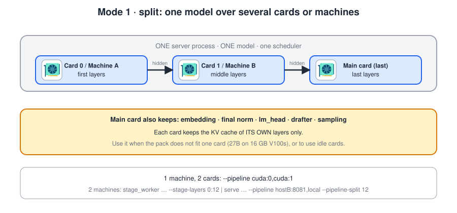
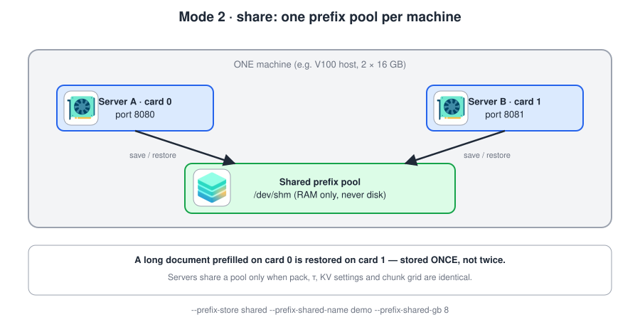
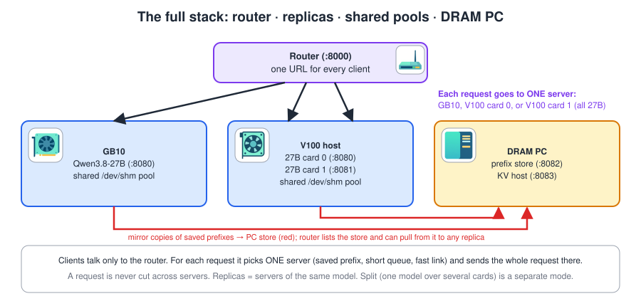

# QVB8 deployment manual

How to run a model on one card, on several cards, on several servers, and on several machines. Every example uses the
launchers in `scripts/` (see the header of each launcher for all its settings). `MODEL` is a downloaded pack folder,
`DRAFT` its drafter. Ports are examples.

Three independent switches decide where bytes live. Each can be on or off, so there are 2 × 2 × 2 = 8 combinations.

| Switch | Question it answers | What moves | Flags |
|---|---|---|---|
| **split** | Where do the model **weights** live? | decoder layers, in contiguous ranges | `--pipeline`, `--pipeline-split`, `--pipeline-reserve-mb` |
| **share** | Where do the saved **prompt prefixes** live? | prefix state + KV of a prompt | `--prefix-store shared`, `--prefix-shared-gb`, `--prefix-shared-name` |
| **PC DRAM pool** | Where does the **overflow** live? | oldest KV blocks, copies of saved prefixes | `--kv-remote`, `--prefix-backup` |

Why saved prefixes matter: prefilling a long prompt is the slow part (minutes). The engine saves the state after a
prefill; the next request with the same beginning (the same document, or the next turn of a chat) restores it and
prefills only what is new. In our V100 test a 94k-token prompt went from 269 s to 66 s.

---

## 1. Split: one model over several cards or machines



One server process places the decoder layers over several cards. Hidden states hop from card to card; the last card is
the main card (embedding, final norm, lm_head, drafter, sampling). Clients see one server.

**Two cards in one machine** (27B on two 16 GB V100s):

```bash
MODEL=./models/Qwen3.8-27B_qvb8r_2e-3_fp16 DRAFT=./models/Qwen3.8-27B-DFlash2_qvb8r_5e-3_fp16 DRAFT_K=7 \
ATTN=sdpa MAX_LIVE=1 scripts/qwen_server.sh start --pipeline cuda:0,cuda:1
```

`--pipeline auto` uses every visible card (`--pipeline cuda:0,cuda:1` chooses them). **The layers are placed
automatically:** without `--pipeline-split` the cut is computed from each layer's weight bytes and each card's free memory (printed at
load). Set it by hand with `--pipeline-split 36` (the first layer of card 1).

**Two machines.** The "other card" is a stage worker on another machine; hidden states cross a TCP link.

```bash
# machine B: runs layers 0..11 only
python -m ai_engine.cli.stage_worker $MODEL --stage-port 8081 --stage-layers 0:12
# machine A: runs layers 12.. plus embedding, lm_head, drafter, sampling
scripts/qwen_server.sh start --pipeline hostB:8081,local --pipeline-split 12
```

Both machines load the same pack with the same `--dtype` and `--kv-*` flags: the layers are numerically coupled. This is
**split**, not a replica: one model, one request path.

Use it when the pack does not fit one card, or to put idle cards to work. On a GB10 (about 120 GB of unified memory) a
27B fits one device, so split is normally off there.

---

## 2. Share: one prefix pool for every server of a machine



`--prefix-store` chooses where saved prefixes live:

| Value | Where | Trade-off |
|---|---|---|
| `gpu` (default) | VRAM, private to the server | instant restore, but a full 16 GB card has no room for them |
| `host` | pinned host RAM, private | copied back to VRAM on restore; two servers keep two copies |
| `shared` | one pool in `/dev/shm` (RAM, never disk) for all servers of the machine | stored once; any server restores it as a view, no copy |

**Two servers, one per card, one pool** (a document prefilled on card 0 can be restored on card 1):

```bash
export MODEL=./models/Qwen3.8-27B_qvb8r_2e-3_fp16 DRAFT=./models/Qwen3.8-27B-DFlash2_qvb8r_5e-3_fp16 DRAFT_K=7
CUDA_VISIBLE_DEVICES=0 INSTANCE=c0 PORT=8080 scripts/qwen_server.sh start \
    --prefix-store shared --prefix-shared-name demo --prefix-shared-gb 8
CUDA_VISIBLE_DEVICES=1 INSTANCE=c1 PORT=8081 scripts/qwen_server.sh start \
    --prefix-store shared --prefix-shared-name demo --prefix-shared-gb 8
```

`CUDA_VISIBLE_DEVICES` picks the card of each server; `INSTANCE` gives each server its own log and pid file. Servers share a pool only when pack, τ, KV settings and the
checkpoint grid are identical; otherwise they do not see each other's prefixes.

Related flags: `--prefix-checkpoint-every N` (mid-prompt checkpoints on a fixed grid of N tokens: a restore prefills at
most N tokens again), `--prefix-state exact|qvb8` (what a checkpoint keeps of the linear-attention state).

---

## 3. PC DRAM pool: overflow goes to a machine that only has RAM


A machine with no GPU (any PC with RAM and Python) runs up to two small services. The release includes both.

```bash
# on the PC.  Prefix store: pure standard library (no torch, no numpy)
python -m ai_engine.servers.prefix_store --mirror http://hostA:8080 --mirror http://hostB:8080 \
    --budget-gb 6 --port 8082
# on the PC.  KV host: numpy backend (or --device cuda:0 to compute on a GPU)
python -m ai_engine.servers.kv_host --port 8083 --budget-gb 8
```

| Service | Server flag | What it does |
|---|---|---|
| **prefix store** | `--prefix-backup http://pc:8082` | mirrors every saved prefix of the listed servers: a **copy**, not a move. The local pool then evicts those entries first, so local RAM goes to live requests. |
| **KV host** | `--kv-remote http://pc:8083` | keeps the oldest KV blocks of long requests **and computes the attention over them**: per layer and step only the queries go out and a small (output, log-sum-exp) comes back, merged with the local part exactly. |

```bash
scripts/qwen_server.sh start --prefix-backup http://pc:8082 --kv-remote http://pc:8083 \
    --kv-window 4096 --kv-cold-block 8192
```

**Link speed decides what is worth moving.** Packed KV is about 28 KB per token (Qwen3.8-27B): a 90k-token prefix is
about 2.5 GB, which is about 20 s over 1 GbE and about 12 minutes over the 3–4 MB/s Wi-Fi we test on; recomputing it
takes 3–4.5 minutes. On a slow link keep KV local and use the PC for prefix copies (pulled only when that saves a
prefill); the KV host pays on a wired LAN.

---

## 4. Cross-machine, cross-GPU prefix sharing


Servers on different machines, with different GPUs, exchange saved prefixes through `POST /v1/pool/pull`. Pieces stream
straight into the receiver's pool and every piece is blake2b-checked; a prefix is published only when all pieces arrived.
A failed pull costs nothing but the prefill it would have saved.

Both sides must report the same **transfer signature**, checked before one byte moves: the same packs (model, format,
τ), KV τ, KV residual, checkpoint grid, dtype and drafter. A GB10 and a V100 can share prefixes as long as they are
started with matching settings.

The **router** (`python -m ai_engine.servers.router`) asks each server which prefixes it holds, sends a request to the
server that already has the longest match, and pulls a prefix to another server only when copying it is faster than
recomputing it (`--pull cost`, the default; `--pull always` to test transfers on a slow link). It learns the link speed
from the pulls.

Set the same `QV_POOL_TOKEN` in the environment of every server, router, store and stage worker. Without it the pool
endpoints are open to the LAN, because a saved prefix contains the token ids of a prompt.

---

## 5. All eight combinations

| # | split | share | PC pool | Use it when |
|---|---|---|---|---|
| 1 | off | off | off | One card, small model, short context. The default launcher. |
| 2 | **on** | off | off | The pack is larger than one card (27B on 16 GB cards), or several cards for one model. |
| 3 | off | **on** | off | Several servers of the same model on one machine (one per card): store each long prefix once. |
| 4 | off | off | **on** | One server, very long contexts, local memory nearly full: overflow goes to the PC. |
| 5 | **on** | **on** | off | Several multi-card servers of one model on one machine (two 2-card servers on a 4-card box). |
| 6 | **on** | off | **on** | One big multi-card model with long-context overflow to the PC. |
| 7 | off | **on** | **on** | Several single-card servers plus a PC: the V100-pair set-up. |
| 8 | **on** | **on** | **on** | Everything: split models, shared pools, PC, one router. |

Minimal commands (`MODEL`, `DRAFT`, `DRAFT_K` exported as in section 2):

```bash
# 1  nothing on
scripts/qwen_server.sh start
# 2  split
scripts/qwen_server.sh start --pipeline cuda:0,cuda:1
# 3  share: two servers, one pool (section 2)
# 4  PC pool
scripts/qwen_server.sh start --kv-remote http://pc:8083 --prefix-backup http://pc:8082 --kv-window 4096 --kv-cold-block 8192
# 5  split + share: two 2-card servers on a 4-card box
INSTANCE=a PORT=8080 scripts/qwen_server.sh start --pipeline cuda:0,cuda:1 --prefix-store shared --prefix-shared-name demo --prefix-shared-gb 8
INSTANCE=b PORT=8081 scripts/qwen_server.sh start --pipeline cuda:2,cuda:3 --prefix-store shared --prefix-shared-name demo --prefix-shared-gb 8
# 6  split + PC pool
scripts/qwen_server.sh start --pipeline cuda:0,cuda:1 --kv-remote http://pc:8083 --prefix-backup http://pc:8082
# 7  share + PC pool: section 2 commands plus  --prefix-backup http://pc:8082  --kv-window 4096
# 8  everything: section 6
```

---

## 6. The full stack, step by step



Three machines, one model (Qwen3.8-27B, the same pack on every box):

| Machine | Hardware | Role |
|---|---|---|
| **PC** | no GPU, 16 GB RAM, Python | prefix store (:8082) + KV host (:8083) |
| **V100 host** | 2 × 16 GB V100 | two servers, one per card (:8080, :8081), shared pool, PC backup |
| **GB10** | 128 GB unified memory | one server (:8080) and the router (:8000) |

**Step 1, the PC** (start the pool services first; the servers point at them):

```bash
export QV_POOL_TOKEN=choose-one-secret
python -m ai_engine.servers.prefix_store --mirror http://gb10:8080 --mirror http://v100host:8080 --budget-gb 6 --port 8082
python -m ai_engine.servers.kv_host --port 8083 --budget-gb 8
curl -s http://127.0.0.1:8082/v1/pool/state       # the saved prefixes it holds
curl -s http://127.0.0.1:8083/health              # {"sessions": 0, ...}
```

**Step 2, the V100 host:**

```bash
export QV_POOL_TOKEN=choose-one-secret MODEL=... DRAFT=... DRAFT_K=7 ATTN=sdpa MAX_LIVE=1
CUDA_VISIBLE_DEVICES=1 INSTANCE=c1 PORT=8080 scripts/qwen_server.sh start --prefix-store shared --prefix-shared-gb 4 \
    --prefix-backup http://pc:8082 --kv-window 4096 --prefill-chunk 512
CUDA_VISIBLE_DEVICES=0 INSTANCE=c0 PORT=8081 scripts/qwen_server.sh start --prefix-store shared --prefix-shared-gb 4 \
    --prefix-backup http://pc:8082 --kv-window 4096 --prefill-chunk 512
```

**Step 3, the GB10:**

```bash
export QV_POOL_TOKEN=choose-one-secret MODEL=... DRAFT=... DRAFT_K=7
scripts/qwen_server.sh start --prefix-store shared --prefix-shared-gb 16 --prefix-backup http://pc:8082
```

**Step 4, the router** (one URL for every client):

```bash
python -m ai_engine.servers.router --port 8000 \
    --backend gb10=http://127.0.0.1:8080 --backend v100c1=http://v100host:8080 --backend v100c0=http://v100host:8081 \
    --store pc=http://pc:8082 --rate gb10=500/15 --rate v100c1=300/12 --rate v100c0=300/12
curl http://localhost:8000/v1/chat/completions -H 'Content-Type: application/json' \
  -d '{"messages":[{"role":"user","content":"hello"}],"max_tokens":50}'
```

`--rate NAME=PREFILL/DECODE` is the measured tokens per second of a replica (used to choose between waiting for a
busy server and prefilling elsewhere).

---

## 7. Traps

- A pool is refused when its fingerprint differs (pack, τ, KV settings, chunk grid). After a launcher change, remove the
  old pool: `rm /dev/shm/qv_prefix_<name>.*` when a server was killed.
- With `--pipeline host:port,local`, the stage worker must use the same `--prefix-store` setting as the main server.
- One 16 GB card holds a 27B only with a small chunk (`--prefill-chunk 512`), `--kv-window 4096` and one live request.
  The first request after a start takes about a minute (kernel compile).
- Restoring a prefix is not the same computation as prefilling it: in our tests greedy output of the 27B was identical,
  but on the 35B-A3B the wording after a restore can differ from a fresh run at temperature 0.
- Do not run a large file copy over the same Wi-Fi while measuring transfers.
- A saved prefix matches only an identical prompt beginning: the same text, the same chat template and the same `think`
  setting. The same text sent with thinking on and thinking off has different leading tokens and does not share a prefix.

---

## 8. Example: a GB10 and a V100 exchanging saved prefixes

The two machines must agree on what is *stored*; they may differ in what they *compute with*.

| Must be the same | May differ |
|---|---|
| pack (model, format, τ), `--dtype`, KV τ and KV residual (set in the launcher), `--prefix-state`, `--prefix-checkpoint-every` | `--prefill-chunk` (as long as the grid is a multiple of it: 12288 = 3 × 4096 = 24 × 512), card, memory, attention backend, `--kv-window`, admission limits |

```bash
export QV_POOL_TOKEN=choose-one-secret
export MODEL=./models/Qwen3.8-27B_qvb8r_2e-3_fp16 DRAFT=./models/Qwen3.8-27B-DFlash2_qvb8r_5e-3_fp16 DRAFT_K=7

# GB10 (128 GB unified memory): large chunk, large pool
scripts/qwen_server.sh start --prefill-chunk 4096 --prefix-checkpoint-every 12288 \
    --prefix-store shared --prefix-shared-gb 16 --prefix-backup http://pc:8082

# V100 (16 GB card): small chunk, KV window, one live request
CUDA_VISIBLE_DEVICES=1 ATTN=sdpa MAX_MEM=16.5 MAX_LIVE=1 MAX_QUEUE=8 scripts/qwen_server.sh start \
    --prefill-chunk 512 --prefix-checkpoint-every 12288 --kv-window 4096 --kv-cold-block 8192 \
    --prefix-store shared --prefix-shared-gb 4 --prefix-backup http://pc:8082
```

Then start the PC store and the router as in section 6. A long document prefilled on the GB10 is mirrored to the PC; when
a request for it reaches the V100, the router pulls the prefix there (if copying is faster than recomputing) and the V100
prefills only the new part. On a V100 add `--vision off` if the vision tower does not fit next to the model.

