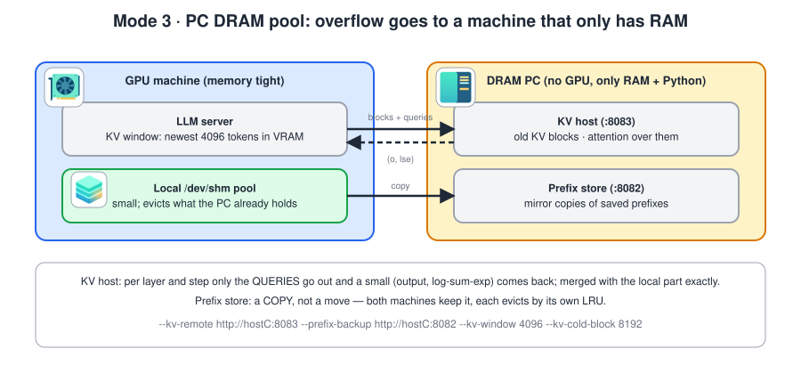
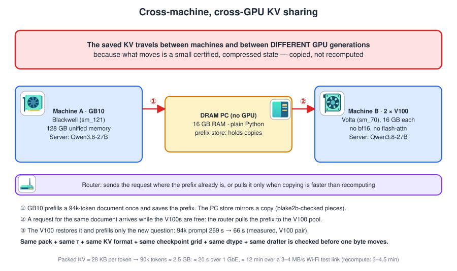
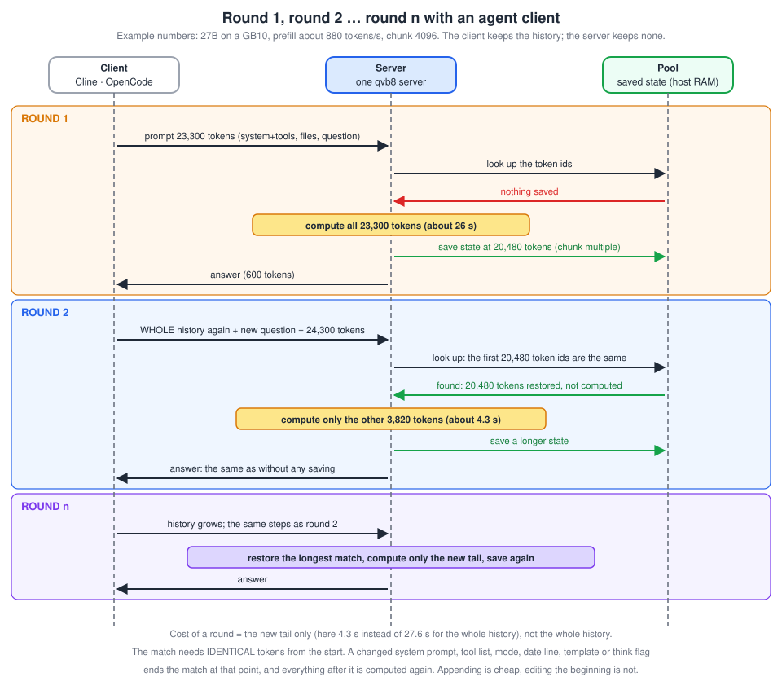
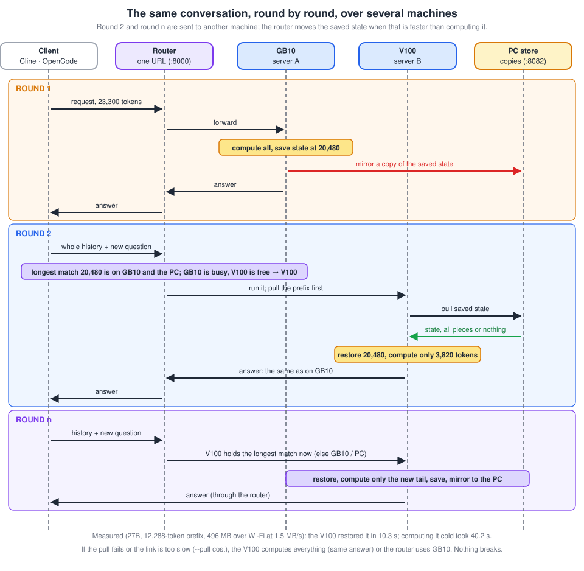
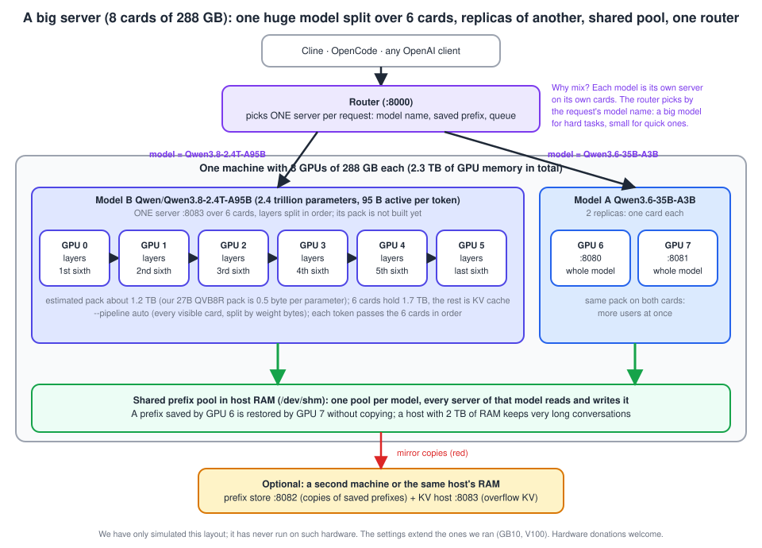
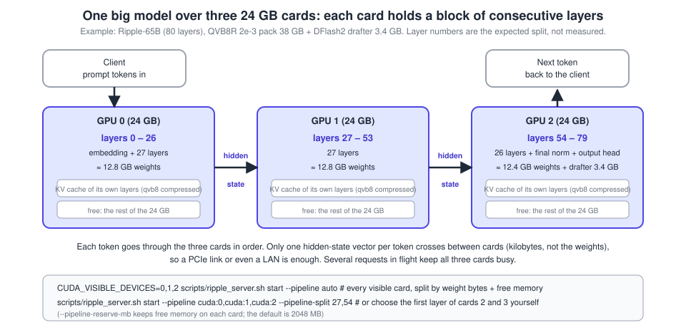
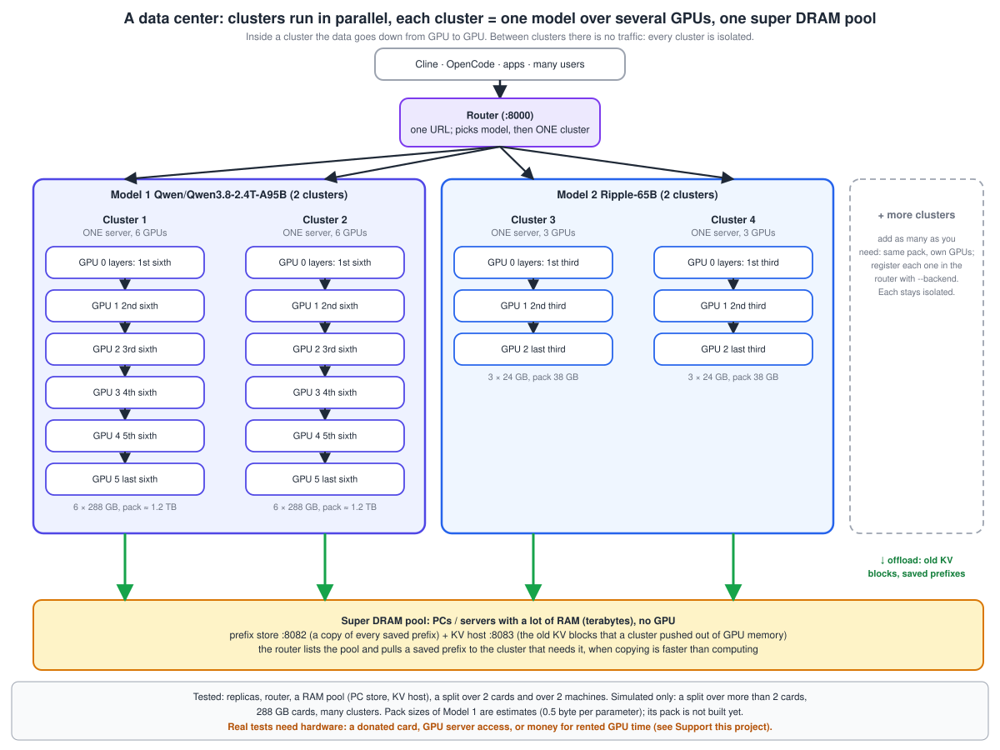

# QVB8 deployment manual

How to run a model on one card, on several cards, on several servers, and on several machines. Every example uses the
launchers in `scripts/` (see the header of each launcher for all its settings). `MODEL` is a downloaded pack folder,
`DRAFT` its drafter. Ports are examples.

Three independent switches decide where bytes live. Each can be on or off, so there are 2 × 2 × 2 = 8 combinations.

| Switch | Question it answers | What moves | Flags |
|---|---|---|---|
| **split** | Where do the model **weights** live? | decoder layers, in contiguous ranges | `--pipeline`, `--pipeline-split`, `--pipeline-reserve-mb` |
| **share** | Where do the saved **prompt prefixes** live? | prefix state + KV of a prompt | `--prefix-store shared`, `--prefix-shared-gb`, `--prefix-shared-name` |
| **PC DRAM pool** | Where does the **overflow** live? | oldest KV blocks, copies of saved prefixes | `--kv-remote`, `--prefix-backup` |

Why saved prefixes matter: prefilling a long prompt is the slow part (minutes). The engine saves the state after a
prefill; the next request with the same beginning (the same document, or the next turn of a chat) restores it and
prefills only what is new. In our V100 test a 94k-token prompt went from 269 s to 66 s.

---

## 1. Split: one model over several cards or machines


One server process places the decoder layers over several cards. Hidden states hop from card to card; the last card is
the main card (embedding, final norm, lm_head, drafter, sampling). Clients see one server.

**Two cards in one machine** (27B on two 16 GB V100s):

```bash
MODEL=./models/Qwen3.8-27B_qvb8r_2e-3_fp16 DRAFT=./models/Qwen3.8-27B-DFlash2_qvb8r_5e-3_fp16 DRAFT_K=7 \
ATTN=sdpa MAX_LIVE=1 scripts/qwen_server.sh start --pipeline cuda:0,cuda:1
```

`--pipeline auto` uses every visible card (`--pipeline cuda:0,cuda:1` chooses them). **The layers are placed
automatically:** without `--pipeline-split` the cut is computed from each layer's weight bytes and each card's free memory (printed at
load). Set it by hand with `--pipeline-split 36` (the first layer of card 1).

**Two machines.** The "other card" is a stage worker on another machine; hidden states cross a TCP link.

```bash
# machine B: runs layers 0..11 only
python -m ai_engine.cli.stage_worker $MODEL --stage-port 8081 --stage-layers 0:12
# machine A: runs layers 12.. plus embedding, lm_head, drafter, sampling
scripts/qwen_server.sh start --pipeline hostB:8081,local --pipeline-split 12
```

Both machines load the same pack with the same `--dtype` and `--kv-*` flags: the layers are numerically coupled. This is
**split**, not a replica: one model, one request path.

Use it when the pack does not fit one card, or to put idle cards to work. On a GB10 (about 120 GB of unified memory) a
27B fits one device, so split is normally off there.

---

## 2. Share: one prefix pool for every server of a machine


`--prefix-store` chooses where saved prefixes live:

| Value | Where | Trade-off |
|---|---|---|
| `gpu` (default) | VRAM, private to the server | instant restore, but a full 16 GB card has no room for them |
| `host` | pinned host RAM, private | copied back to VRAM on restore; two servers keep two copies |
| `shared` | one pool in `/dev/shm` (RAM, never disk) for all servers of the machine | stored once; any server restores it as a view, no copy |

**Two servers, one per card, one pool** (a document prefilled on card 0 can be restored on card 1):

```bash
export MODEL=./models/Qwen3.8-27B_qvb8r_2e-3_fp16 DRAFT=./models/Qwen3.8-27B-DFlash2_qvb8r_5e-3_fp16 DRAFT_K=7
CUDA_VISIBLE_DEVICES=0 INSTANCE=c0 PORT=8080 scripts/qwen_server.sh start \
    --prefix-store shared --prefix-shared-name demo --prefix-shared-gb 8
CUDA_VISIBLE_DEVICES=1 INSTANCE=c1 PORT=8081 scripts/qwen_server.sh start \
    --prefix-store shared --prefix-shared-name demo --prefix-shared-gb 8
```

`CUDA_VISIBLE_DEVICES` picks the card of each server; `INSTANCE` gives each server its own log and pid file. Servers share a pool only when pack, τ, KV settings and the
checkpoint grid are identical; otherwise they do not see each other's prefixes.

Related flags: `--prefix-checkpoint-every N` (mid-prompt checkpoints on a fixed grid of N tokens: a restore prefills at
most N tokens again), `--prefix-state exact|qvb8` (what a checkpoint keeps of the linear-attention state).

---

## 3. PC DRAM pool: overflow goes to a machine that only has RAM



A machine with no GPU (any PC with RAM and Python) runs up to two small services. The release includes both.

```bash
# on the PC.  Prefix store: pure standard library (no torch, no numpy)
python -m ai_engine.servers.prefix_store --mirror http://hostA:8080 --mirror http://hostB:8080 \
    --budget-gb 6 --port 8082
# on the PC.  KV host: numpy backend (or --device cuda:0 to compute on a GPU)
python -m ai_engine.servers.kv_host --port 8083 --budget-gb 8
```

| Service | Server flag | What it does |
|---|---|---|
| **prefix store** | `--prefix-backup http://pc:8082` | mirrors every saved prefix of the listed servers: a **copy**, not a move. The local pool then evicts those entries first, so local RAM goes to live requests. |
| **KV host** | `--kv-remote http://pc:8083` | keeps the oldest KV blocks of long requests **and computes the attention over them**: per layer and step only the queries go out and a small (output, log-sum-exp) comes back, merged with the local part exactly. |

```bash
scripts/qwen_server.sh start --prefix-backup http://pc:8082 --kv-remote http://pc:8083 \
    --kv-window 4096 --kv-cold-block 8192
```

**Link speed decides what is worth moving.** Packed KV is about 28 KB per token (Qwen3.8-27B): a 90k-token prefix is
about 2.5 GB, which is about 20 s over 1 GbE and about 12 minutes over the 3–4 MB/s Wi-Fi we test on; recomputing it
takes 3–4.5 minutes. On a slow link keep KV local and use the PC for prefix copies (pulled only when that saves a
prefill); the KV host pays on a wired LAN.

---

## 4. Cross-machine, cross-GPU prefix sharing



Servers on different machines, with different GPUs, exchange saved prefixes through `POST /v1/pool/pull`. Pieces stream
straight into the receiver's pool and every piece is blake2b-checked; a prefix is published only when all pieces arrived.
A failed pull costs nothing but the prefill it would have saved.

Both sides must report the same **transfer signature**, checked before one byte moves: the same packs (model, format,
τ), KV τ, KV residual, checkpoint grid, dtype and drafter. A GB10 and a V100 can share prefixes as long as they are
started with matching settings.

The **router** (`python -m ai_engine.servers.router`) asks each server which prefixes it holds, sends a request to the
server that already has the longest match, and pulls a prefix to another server only when copying it is faster than
recomputing it (`--pull cost`, the default; `--pull always` to test transfers on a slow link). It learns the link speed
from the pulls.

Set the same `QV_POOL_TOKEN` in the environment of every server, router, store and stage worker. Without it the pool
endpoints are open to the LAN, because a saved prefix contains the token ids of a prompt.

---

## 5. All eight combinations

| # | split | share | PC pool | Use it when |
|---|---|---|---|---|
| 1 | off | off | off | One card, small model, short context. The default launcher. |
| 2 | **on** | off | off | The pack is larger than one card (27B on 16 GB cards), or several cards for one model. |
| 3 | off | **on** | off | Several servers of the same model on one machine (one per card): store each long prefix once. |
| 4 | off | off | **on** | One server, very long contexts, local memory nearly full: overflow goes to the PC. |
| 5 | **on** | **on** | off | Several multi-card servers of one model on one machine (two 2-card servers on a 4-card box). |
| 6 | **on** | off | **on** | One big multi-card model with long-context overflow to the PC. |
| 7 | off | **on** | **on** | Several single-card servers plus a PC: the V100-pair set-up. |
| 8 | **on** | **on** | **on** | Everything: split models, shared pools, PC, one router. |

Minimal commands (`MODEL`, `DRAFT`, `DRAFT_K` exported as in section 2):

```bash
# 1  nothing on
scripts/qwen_server.sh start
# 2  split
scripts/qwen_server.sh start --pipeline cuda:0,cuda:1
# 3  share: two servers, one pool (section 2)
# 4  PC pool
scripts/qwen_server.sh start --kv-remote http://pc:8083 --prefix-backup http://pc:8082 --kv-window 4096 --kv-cold-block 8192
# 5  split + share: two 2-card servers on a 4-card box
INSTANCE=a PORT=8080 scripts/qwen_server.sh start --pipeline cuda:0,cuda:1 --prefix-store shared --prefix-shared-name demo --prefix-shared-gb 8
INSTANCE=b PORT=8081 scripts/qwen_server.sh start --pipeline cuda:2,cuda:3 --prefix-store shared --prefix-shared-name demo --prefix-shared-gb 8
# 6  split + PC pool
scripts/qwen_server.sh start --pipeline cuda:0,cuda:1 --kv-remote http://pc:8083 --prefix-backup http://pc:8082
# 7  share + PC pool: section 2 commands plus  --prefix-backup http://pc:8082  --kv-window 4096
# 8  everything: section 6
```

---

## 6. The full stack, step by step


Three machines, one model (Qwen3.8-27B, the same pack on every box):

| Machine | Hardware | Role |
|---|---|---|
| **PC** | no GPU, 16 GB RAM, Python | prefix store (:8082) + KV host (:8083) |
| **V100 host** | 2 × 16 GB V100 | two servers, one per card (:8080, :8081), shared pool, PC backup |
| **GB10** | 128 GB unified memory | one server (:8080) and the router (:8000) |

**Step 1, the PC** (start the pool services first; the servers point at them):

```bash
export QV_POOL_TOKEN=choose-one-secret
python -m ai_engine.servers.prefix_store --mirror http://gb10:8080 --mirror http://v100host:8080 --budget-gb 6 --port 8082
python -m ai_engine.servers.kv_host --port 8083 --budget-gb 8
curl -s http://127.0.0.1:8082/v1/pool/state       # the saved prefixes it holds
curl -s http://127.0.0.1:8083/health              # {"sessions": 0, ...}
```

**Step 2, the V100 host:**

```bash
export QV_POOL_TOKEN=choose-one-secret MODEL=... DRAFT=... DRAFT_K=7 ATTN=sdpa MAX_LIVE=1
CUDA_VISIBLE_DEVICES=1 INSTANCE=c1 PORT=8080 scripts/qwen_server.sh start --prefix-store shared --prefix-shared-gb 4 \
    --prefix-backup http://pc:8082 --kv-window 4096 --prefill-chunk 512
CUDA_VISIBLE_DEVICES=0 INSTANCE=c0 PORT=8081 scripts/qwen_server.sh start --prefix-store shared --prefix-shared-gb 4 \
    --prefix-backup http://pc:8082 --kv-window 4096 --prefill-chunk 512
```

**Step 3, the GB10:**

```bash
export QV_POOL_TOKEN=choose-one-secret MODEL=... DRAFT=... DRAFT_K=7
scripts/qwen_server.sh start --prefix-store shared --prefix-shared-gb 16 --prefix-backup http://pc:8082
```

**Step 4, the router** (one URL for every client):

```bash
python -m ai_engine.servers.router --port 8000 \
    --backend gb10=http://127.0.0.1:8080 --backend v100c1=http://v100host:8080 --backend v100c0=http://v100host:8081 \
    --store pc=http://pc:8082 --rate gb10=500/15 --rate v100c1=300/12 --rate v100c0=300/12
curl http://localhost:8000/v1/chat/completions -H 'Content-Type: application/json' \
  -d '{"messages":[{"role":"user","content":"hello"}],"max_tokens":50}'
```

`--rate NAME=PREFILL/DECODE` is the measured tokens per second of a replica (used to choose between waiting for a
busy server and prefilling elsewhere).

---

## 7. Traps

- A pool is refused when its fingerprint differs (pack, τ, KV settings, chunk grid). After a launcher change, remove the
  old pool: `rm /dev/shm/qv_prefix_<name>.*` when a server was killed.
- With `--pipeline host:port,local`, the stage worker must use the same `--prefix-store` setting as the main server.
- One 16 GB card holds a 27B only with a small chunk (`--prefill-chunk 512`), `--kv-window 4096` and one live request.
  The first request after a start takes about a minute (kernel compile).
- Restoring a prefix is not the same computation as prefilling it: in our tests greedy output of the 27B was identical,
  but on the 35B-A3B the wording after a restore can differ from a fresh run at temperature 0.
- Do not run a large file copy over the same Wi-Fi while measuring transfers.
- A saved prefix matches only an identical prompt beginning: the same text, the same chat template and the same `think`
  setting. The same text sent with thinking on and thinking off has different leading tokens and does not share a prefix.

---

## 8. Example: a GB10 and a V100 exchanging saved prefixes

The two machines must agree on what is *stored*; they may differ in what they *compute with*.

| Must be the same | May differ |
|---|---|
| pack (model, format, τ), `--dtype`, KV τ and KV residual (set in the launcher), `--prefix-state`, `--prefix-checkpoint-every` | `--prefill-chunk` (as long as the grid is a multiple of it: 12288 = 3 × 4096 = 24 × 512), card, memory, attention backend, `--kv-window`, admission limits |

```bash
export QV_POOL_TOKEN=choose-one-secret
export MODEL=./models/Qwen3.8-27B_qvb8r_2e-3_fp16 DRAFT=./models/Qwen3.8-27B-DFlash2_qvb8r_5e-3_fp16 DRAFT_K=7

# GB10 (128 GB unified memory): large chunk, large pool
scripts/qwen_server.sh start --prefill-chunk 4096 --prefix-checkpoint-every 12288 \
    --prefix-store shared --prefix-shared-gb 16 --prefix-backup http://pc:8082

# V100 (16 GB card): small chunk, KV window, one live request
CUDA_VISIBLE_DEVICES=1 ATTN=sdpa MAX_MEM=16.5 MAX_LIVE=1 MAX_QUEUE=8 scripts/qwen_server.sh start \
    --prefill-chunk 512 --prefix-checkpoint-every 12288 --kv-window 4096 --kv-cold-block 8192 \
    --prefix-store shared --prefix-shared-gb 4 --prefix-backup http://pc:8082
```

Then start the PC store and the router as in section 6. A long document prefilled on the GB10 is mirrored to the PC; when
a request for it reaches the V100, the router pulls the prefix there (if copying is faster than recomputing) and the V100
prefills only the new part. On a V100 add `--vision off` if the vision tower does not fit next to the model.

---

## 9. Editors (Cline) and keeping a conversation going

### 9.1 Cline in VS Code

Cline → Settings → API Provider **OpenAI Compatible**:

| Field | Value |
|---|---|
| Base URL | `http://HOST:8080/v1`, or the router `http://HOST:8000/v1` |
| API Key | any non-empty text; the server does not check it (`QV_POOL_TOKEN` is only for server-to-server pool traffic) |
| Model ID | any text with one model up; behind a router with several models use an id from `GET /v1/models` |
| Context window | your choice, up to the server's limit (`--max-live-tokens`); 16 GB V100: start with 32768 |

Cline sends a long system prompt (many thousand tokens) at every step. That is exactly what a saved prefix is for: after the
first step the server restores it instead of computing it again. Reasoning (`<think>`) makes answers slower; start the
server with `--no-think` if you want direct answers for editing work.
Used with Cline in VS Code for long coding tasks on V100 cards: slower than a big GPU, but a long task runs to the end.

### 9.2 Why the conversation can move

The API is stateless: the client sends the full message list every time. The server stores only the computed state of
the beginning of the list (the prefix) under a key made from the exact tokens. Any server that can get that state
continues without computing it; any server that cannot computes it again and gives the same answer.

### 9.3 All cases

| # | Situation | Setup | What happens | Speed |
|---|---|---|---|---|
| 1 | Same server, next message | any | own pool restores the prefix | fast |
| 2 | Server restarted | `--prefix-backup http://pc:8082` (the PC copy survives a restart of the server and of the GPU machine) | restored from the PC copy when the router pulls it | fast if the link is fast |
| 3 | Other card, same machine | both servers `--prefix-store shared --prefix-shared-name X` | one pool, one copy | fast |
| 4 | Other machine, router + PC store | `--prefix-backup http://pc:8082` on the servers; router with `--store` (section 6) | router pulls the prefix when copying is faster than computing (`--pull cost`) | fast if the link is fast; on slow Wi-Fi it may prefer computing |
| 5 | Other machine, nothing shared | none | whole history computed again | slow, same answer |
| 6 | Other card, other GPU type (GB10 ↔ V100) | same pack, `--dtype`, KV τ and residual, checkpoint grid (section 8) | the saved state is certified data, so it restores on any card | as case 4 |
| 7 | Different pack, τ, KV setting | — | refused by the signature check, computed again | slow |
| 8 | History changed at the start (new system prompt, other template, `think` flipped) | — | the prefix matches only up to the first difference | partly fast |

Case 8 is the one that surprises people: Cline changing mode, or a different system prompt, moves the first difference
towards the beginning, and everything after it is computed again.

### 9.4 Moving a Cline task to another machine

1. Start the other server (or the router) as in section 6 or 8, with the same pack and the same KV settings.
2. In Cline change **Base URL** to the other server and send the next message. Cline sends the whole history.
3. Behind the router nothing changes at all: keep one Base URL; the router picks the server that has the longest
   matching prefix, or pulls it.

The terminal chat keeps its history only in memory; use `/reset` or a new window to start again. It cannot hand a
conversation to another machine; Cline (which stores the history itself) can.


---

## 10. Several rounds, in detail (Cline, OpenCode and other agents)

An agent such as Cline or OpenCode works in many rounds: read a file, think, call a tool, read the result, think again.
**Every round is a new HTTP request that contains the whole history again.** The server keeps no conversation. What it
keeps is *computed state* for the beginning of the history, found again by the exact token ids. This is why the same
engine is fast for an agent: round 2 is the same long beginning plus a little new text.



What happens, in order (the numbers are an example: 27B on a GB10, prefill about 880 tokens/s, chunk 4096):

| Step | Round 1 (23,300 tokens) | Round 2 (24,300 tokens) |
|---|---|---|
| 1. Request arrives | system prompt + tools 9,000, files 14,000, question 300 | the same 23,300 tokens, the answer 600, the new question 400 |
| 2. Look-up | nothing saved | the first 20,480 token ids equal a saved state → found |
| 3. Compute | all 23,300 tokens, about 26 s | restore the state (no computing), compute the other 3,820 tokens, about 4.3 s |
| 4. Save | state at 20,480 tokens (a multiple of the chunk) into the pool | a new, longer state for round 3 |
| 5. Answer | 600 tokens | the same answer as without any saving |

What is saved: the attention KV of the full-attention layers (compressed, with a proven error bound) and the state of
the linear-attention layers, at a chunk boundary of the prompt. It lives in the pool you chose with `--prefix-store`
(`gpu`, `host`, or `shared`) and, with `--prefix-backup`, as a copy on the PC.

**Round 2 on another machine or card.** The client sends the same request to the router; the router knows which server
holds the longest match and may move it:



Same card pair, same machine: a shared pool, no copy at all (section 2). Another machine: the router pulls the saved
state (section 4) when copying is faster than computing; it is checked by hash and by the transfer signature, and a
failed pull costs nothing but the prefill it would have saved.

**What spoils the match** (Cline, OpenCode):
- a system prompt, tool list, mode, date or working-directory line that changes between rounds: everything after the change is computed again;
- another chat template or thinking switched on/off between rounds;
- a client that removes old tool results from the history ("context pruning"): the match stops where the history was cut.
  Appending is cheap, editing the beginning is not.

---

## 11. From a toy to a real server

The same engine runs on one 16 GB card on a desk and on a rack server. Nothing changes in the design: a **replica** is
one server on one card, a **split** is one server over several cards, the **pool** is host RAM, the **router** is one
URL. A big machine just has more of each. The picture below is a deployment for an 8-GPU machine with 288 GB per card;
**we have only simulated it and never run it on H100 / H200 / H300 hardware**; the settings extend the ones we did run (GB10,
V100 cards, a PC store). To test it for real the project needs hardware: a donated card, GPU server access, or money for
rented GPU time (see Support this project in the README).



| Part | In the picture | Flag / command | Tested on |
|---|---|---|---|
| Replicas of one model | Model A on GPU 6, 7 | one `qwen_server.sh` per card: `CUDA_VISIBLE_DEVICES=i INSTANCE=ai PORT=808x` | two V100 cards, one GB10 |
| One model over several cards | Model B (Qwen/Qwen3.8-2.4T-A95B) on GPU 0–5 | `--pipeline auto` (all visible cards) or `--pipeline cuda:0,cuda:1,...,cuda:5` | two V100 cards (27B); more than two cards simulated only |
| Shared prefix pool | green strip | `--prefix-store shared --prefix-shared-name NAME --prefix-shared-gb N` (the host's `/dev/shm` must be big enough) | yes |
| Copies and overflow on another machine | amber box | `--prefix-backup`, `--kv-remote`, `prefix_store`, `kv_host` | yes (PC with 16 GB) |
| One URL, routing by model name | router | `servers.router --backend NAME=URL ... --store ...` | yes |

**Commands for the 8-GPU machine of the picture** (`QV_POOL_TOKEN` exported as in section 6; replace the pack paths):

```bash
# Model B: Qwen/Qwen3.8-2.4T-A95B over cards 0-5. No pack of it exists yet: this is the shape of the command.
# Estimated size: about 1.2 TB at 0.5 byte per parameter (our 27B QVB8R 2e-3 pack); 6 x 288 GB = 1.7 TB leaves room for KV cache.
CUDA_VISIBLE_DEVICES=0,1,2,3,4,5 INSTANCE=big PORT=8083 ATTN=flash_attention_2 MAX_MEM=280 \
  MODEL=./models/<2.4T pack> DRAFT=./models/<its drafter> DRAFT_K=<its K> \
  scripts/qwen_server.sh start --pipeline auto --prefix-store shared --prefix-shared-name big --prefix-shared-gb 400

# Model A: Qwen3.6-35B-A3B, two replicas (cards 6 and 7), one pool "modelA"
for i in 6 7; do
  CUDA_VISIBLE_DEVICES=$i INSTANCE=a$i PORT=$((8074+i)) ATTN=flash_attention_2 MAX_MEM=280 MAX_LIVE=32 \
  MODEL=./models/Qwen3.6-35B-A3B_qvb8_5e-4_fp16 DRAFT=./models/Qwen3.6-35B-A3B-DFlash2_qvb8_1e-3 DRAFT_K=7 \
  scripts/qwen_server.sh start --prefill-chunk 12288 --prefix-checkpoint-every 12288 \
      --prefix-store shared --prefix-shared-name modelA --prefix-shared-gb 100
done

# the router: one URL; the "model" field of the request picks B or A, the router picks the replica of A
python -m ai_engine.servers.router --port 8000 \
  --backend big=http://127.0.0.1:8083 --backend a6=http://127.0.0.1:8080 --backend a7=http://127.0.0.1:8081 \
  --max-inflight a6=8 --max-inflight a7=8
```

Rules for a big machine: servers share a pool only with the same pack, τ and KV settings (one pool name per model);
`MAX_MEM` is the ceiling per server, set it near the card's memory; raise `--max-live` / `--max-live-tokens` with the
free memory; `--prefill-chunk 12288` prefills a long prompt faster when memory allows.

### 11.1 One big model over three 24 GB cards



The pack is cut into blocks of consecutive layers, one block per card; each token passes the cards in order and only a
hidden-state vector crosses between them. Example: the Ripple-65B QVB8R 2e-3 pack (38 GB, 80 layers) on 3 × 24 GB:

```bash
CUDA_VISIBLE_DEVICES=0,1,2 MODEL=./models/Ripple-65B-Preview-QVB8R-2e-3 DRAFT=./models/Ripple-65B-Preview-DFlash2-QVB8R-5e-3 \
  scripts/ripple_server.sh start --pipeline auto
# or choose the first layer of cards 2 and 3 yourself:  --pipeline cuda:0,cuda:1,cuda:2 --pipeline-split 27,54
```

`--pipeline auto` splits by weight bytes and each card's free memory (minus `--pipeline-reserve-mb`, default 2048 MB), so
unequal cards are fine. We ran a two-card split (27B on two V100s); the three-card layout is the same code with N = 3 and
has not been run on real cards.

### 11.2 A data center: many isolated clusters, one super DRAM pool



- A **cluster** is one server that holds one model over several GPUs: each GPU has a block of consecutive layers
  (`--pipeline`), and a token goes down from GPU to GPU. Nothing is sent between clusters: they are isolated and run in
  parallel, so more clusters mean more requests at once.
- The picture has two models: **Model 1, Qwen/Qwen3.8-2.4T-A95B**, two clusters of 6 GPUs; **Model 2, Ripple-65B**, two
  clusters of 3 cards. Add more clusters of the same pack as needed: start the server, register it in the router with
  `--backend NAME=URL`, done.
- Every cluster pushes what does not fit in its GPUs to the **super DRAM pool**: machines with terabytes of RAM and no GPU
  that run the prefix store (`--prefix-backup`) and the KV host (`--kv-remote`), see section 3. The router lists the pool
  and pulls a saved prefix to the cluster that needs it, when copying is faster than computing.

What has run and what has not: replicas, the router, the RAM pool (a PC store and KV host), a split over two cards and
over two machines (Wi-Fi) have run. A split over more than two cards, clusters of 6 GPUs, 288 GB cards and many clusters
have **only been simulated**. The Model 1 pack does not exist yet, and its size (about 1.2 TB) is an estimate. Real tests
need hardware (see Support this project in the README).
